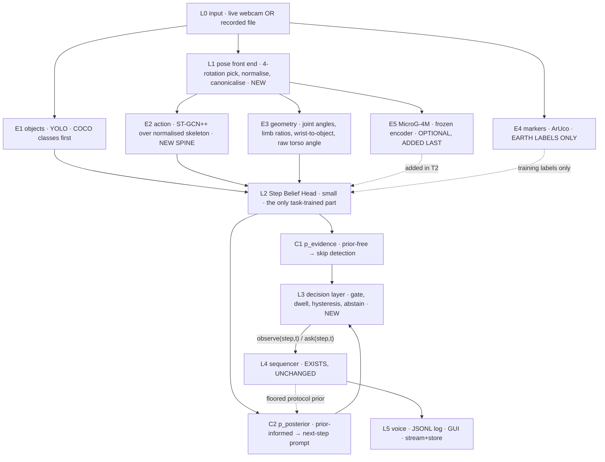

# ACTUS Stage 3: demo-grade plan — skeleton spine, microgravity model as the differentiator

2026-09-27 · v3, supersedes v2 · companions: `Stage2.md` (shoot plan), `Stage3.md` (export protocol),
`Lightweight_everyday_action_recognition_models.md` (model survey)

> **Superseded for the current sprint:** the deadline is 2 days and the demo is a recorded
> walkthrough, so §9's tiers no longer apply as written. The execution plan is
> `Stage3-Demo-Plan.md`, which cuts new filming, ST-GCN++/MMAction2 and the trained step
> classifier. Everything else here — the streams, the two belief channels, the decision layer,
> the skeleton-as-Earth-to-orbit-bridge argument in §1–2 — still holds and is what the demo
> plan builds on.

## 0. What changed in v3

Two inputs reshape the plan:

1. **"Good enough for a demo, not robust enough for deployment."** This is a licence to cut, and
   §7 is an explicit cut list. Anything whose only purpose is to make a *deployment* claim
   defensible is gone.
2. **The lightweight-model survey.** It points at a two-stage skeleton pipeline — pose estimator
   feeding a small graph-convolutional classifier — and that is a better spine for this project
   than the RGB clip model v1 and v2 were built around. §1.

The net effect is that the plan gets **smaller, cheaper and more likely to work**, and the
MicroG-4M integration moves from "critical path" to "the interesting part we add once the
demo already works". That is the correct risk posture when the deliverable is a demo.

Carried forward unchanged from v2: the FSM is real and its *input* is what's missing; the model
sits **below** the FSM as a sensor, not above it as an authority; `sequencer.py` is not modified;
a step is identified by the triple (action, object, transition); and the two-channel belief split
that stops the protocol prior from masking skipped steps.

## 1. The headline change: the skeleton pipeline becomes the spine

Per the survey, **RTMPose or MediaPipe Pose → ST-GCN++** is the recommended lightweight route:
ST-GCN++ at ~1.4M parameters and 1.95–2.96 GFLOPs per stream reaching 89.29% joint-only top-1
on NTU RGB+D 60 cross-subject, with RTMPose reporting 430+ FPS on a GTX 1660 Ti — a *weaker*
card than our RTX 4070 laptop. PoseC3D is the fallback where 2D keypoints get unreliable
(94.0% fused on NTU60 X-Sub, and documented robustness to noisy pose). All figures are the
survey's; none independently verified here.

Five reasons this is the right spine for ACTUS specifically, beyond raw efficiency:

1. **Skeleton input is the best Earth→orbit bridge available to us.** This is the important one.
   The RGB domain gap between a bedroom and an ISS module is enormous — different hardware,
   textures, clutter, lighting, Nomex and Velcro everywhere. The *skeleton* gap is small: a
   normalised stick-figure turning a valve looks nearly the same in both places. Since we
   train only on Earth footage (confirmed decision), throwing appearance away before the
   classifier sees it removes most of the gap we cannot otherwise close.
2. **Orientation-agnosticism becomes nearly free**, which is the problem statement's optional
   requirement. §2.
3. **Maintained tooling.** MMAction2 + MMDeploy host ST-GCN++, PoseC3D, X3D and TSM under one
   fine-tuning framework. Compare v2's kill-risk: PySlowFast is CUDA-oriented and effectively
   unmaintained against torch 2.14.
4. **We need the checkpoint, not the dataset.** Fine-tuning from MMAction2's NTU60/120
   pretrained ST-GCN++ weights avoids NTU's academic release agreement and 1.3–2.3 TB
   download entirely. Large practical saving, and it was a hidden cost in every earlier draft.
5. **Licence-clean for a competition.** MMAction2/ST-GCN++ and RTMPose are Apache-2.0, HD-GCN
   is MIT. Avoid VideoMAE-small (CC-BY-NC-4.0) and 100DOH/EgoHOS (non-commercial). Note that
   Ultralytics YOLO, already in the repo, is AGPL-3.0 or paid commercial — fine for a
   hackathon, worth knowing before anything is published.

## 2. The gravity prior moved — and that is good news

With a skeleton pipeline, the classifier can be made orientation-invariant almost trivially.
But the prior does not disappear; **it relocates into the pose estimator**, which is the
component now carrying an Earth assumption. RTMPose and MediaPipe are trained on upright
people. In orbit the astronaut is at arbitrary roll, sometimes inverted.

This is a better place for the problem to live, because the fix is cheap and local:

1. **Run pose at four rotations** (0/90/180/270) and keep the pass with the highest mean
   landmark confidence. This is exactly the trick `perception.py` already applies to YOLO, but
   generalised and — crucially — **marker-free**, which removes ArUco from the orbit path
   entirely. Affordable because batch inference is acceptable.
2. **Normalise the skeleton** before the classifier: hip-centre it, scale-normalise by torso
   length, and canonicalise the torso axis so the spine points a fixed way. After that the
   action classifier has no access to "up" at all, so it cannot depend on it.
3. **Keep the raw torso angle as a separate feature.** Canonicalising deletes absolute
   orientation, which is what we want for the action classifier but not for the problem
   statement's *"relative to the payload rack, not the floor"* phrasing. Retain the
   pre-normalisation torso vector as its own evidence channel so body-relative-to-scene
   information is still available if a step needs it.
4. **PoseC3D as the fallback** if 2D keypoints turn out too noisy on real orbit footage — its
   heatmap representation is the survey's recommended hedge for exactly that.

This replaces v2's four-mechanism orientation section, and it satisfies the optional
requirement better than the marker-based levelling that exists today, at lower cost than the
SMPL/HMR route v2 floated. **HMR is cut** (§7).

## 3. So what is MicroG-4M for now?

It is the **differentiator, not the spine**, and this is a promotion in usefulness even though
it is a demotion in priority.

What a skeleton pipeline pretrained on NTU *cannot* give us: microgravity-specific action
semantics. NTU's 82 daily-action classes are Earth actions performed by people standing on
floors. It has no representation of floating, push-off, tether and handrail use, or how a body
moves when it has no weight. That is precisely the gap MicroG-4M was built to fill, and it is
the part of this project that is genuinely novel and ISRO-relevant.

So the posture is: **build the skeleton spine first, add MicroG-4M as one more evidence stream
once the demo already works.** The fusion layer accepts streams by design, so adding it costs
nothing architecturally. If it loads and helps, it is the interesting result. If it will not
load — a real possibility, verification still outstanding — the demo is unaffected.

**One warning from v2 still stands, and it is not contradicted by §5.** Do not fully fine-tune
MicroG-4M's backbone on Earth-only footage: its value *is* the microgravity prior, and Earth
fine-tuning overwrites exactly that, invisibly, while improving every Earth metric. Freeze it
and train only a head on top.

## 4. The revised architecture

Simpler than v2. New work is L2–L3 plus the pose front end; everything from L4 down exists.

## 5. Updated answer to the query, and the simplification it allows

> *Would the action scores predicted by the MicroG model need an ACTUS classifier to make use
> of them?*

**Still yes** — the three reasons from v2 hold (vocabulary, granularity and context all
mismatch between generic atomic actions and protocol steps). But the skeleton spine allows a
shortcut that the RGB path did not:

| Option | How | Verdict |
|---|---|---|
| **(a) Fine-tune ST-GCN++ to output our step classes directly** | Replace the NTU head with a `step_graph` head, fine-tune on our small Earth set | **Recommended for the demo.** Collapses two stages into one. At ~1.4M parameters it overfits far less readily than a large model would, and fine-tuning on a small custom set is exactly the workflow the survey describes. |
| (b) Pretrained action scores + geometric features → small step head | Keep ST-GCN++ frozen, learn a separate head | Fallback if (a) overfits or if our take count lands very low. More modular, easier to debug. |

**Why (a) is not a contradiction of §3's do-not-fine-tune warning.** That warning is specific
to MicroG-4M, whose *whole value* is a microgravity prior we would be destroying. ST-GCN++'s
NTU prior is Earth-daily-action — there is no microgravity prior in it to protect — and
skeleton normalisation (§2) already handles the orientation part. Fine-tuning ST-GCN++ is fine.
Fine-tuning MicroG-4M on Earth data is not. Different components, different reasoning.

The head still needs a **horizon longer than one window** — steps run 5–60 s and are defined by
transitions — so feed it a sequence of windows (10–30 s of context), not a single one.

## 6. Concrete code findings to act on

From a completed audit of the IO/GUI/logging layers. These are cheap, specific, and several are
latent traps that would only surface once a model drives the pipeline.

| # | Finding | Action |
|---|---|---|
| 1 | **Stream-to-IP and local video storage are 0% implemented.** `video_source.py`'s own docstring admits the disk writer and network streamer "are not implemented yet". The only `VideoWriter` in the repo is in `tests/test_gui.py`, fabricating a test *input*. | Required deliverable with **no research risk** — schedule it early, not in the last week. |
| 2 | **Two divergent file-playback paths**, neither using `VideoSource`: `video_worker.py`'s `_run_file`/`_read_ahead` (threaded, backpressured, lossless) and `run_fsm.py`'s `file_frames()` (plain synchronous generator). Every call site branches on `isinstance(src, int)` before reaching `VideoSource`. | Leave it that way. **Do not route files through `VideoSource`** — on a file, EOF is indistinguishable from a disconnected camera, so it reopens and silently loops the file forever. |
| 3 | **Clip buffer, offline path:** add a `deque(maxlen=N)` inside the existing synchronous per-frame loop. Lossless already, no new machinery. | Do this for the astronaut clip. |
| 4 | **Clip buffer, live path:** `Subscription._offer` drops the oldest frame at `maxsize=2` (both current call sites use the default). A gap-free window is achievable but not guaranteed — one stall corrupts it silently, with no exception and no marker. | Give the clip consumer its own subscription at `maxsize` 90–180, pull with blocking `read()` not `read_latest()`, and check `frame.index == prev + 1` on every pull; refill from scratch on a gap. `Frame.index` is a single capture-thread counter shared across subscribers, and `Subscription.dropped` already counts drops — both free, both currently unread. |
| 5 | **Key any precomputed score cache by frame index, not by time.** `t = index / fps` with `fps = cap.get(CAP_PROP_FPS) or 30.0` — the fallback silently invents 30 fps for a file with unreadable metadata, and a variable-frame-rate source drifts over a long take. | Index is exact, fps-independent, and already threaded everywhere (`_on_frame(image, t, index)`, `Frame.index`). |
| 6 | **`ScriptSource` never reads the `frame` column** — it parses only `time_s`, despite `HotkeySource` writing `frame` out. So the load-bearing timeline today is a derived float. | Worth fixing while touching the schema; it makes index-keying consistent end to end. |
| 7 | **`Session.advance(t)` takes no frame index**, though both callers have one and discard it. | Thread `index` through if the cache is index-keyed. Small and local. |
| 8 | **`Session` accepts any object with `.due(t)`** — no ABC, no isinstance check. | A `CachedScoreSource` or `StepClassifierSource` plugs in with **zero changes to `sequencer.py` or `session.py`**. Confirms v2's central architectural bet. |
| 9 | **The voice queue is unbounded with no dedup or staleness check.** Fine for a scripted demo; a noisy classifier will produce bursts, and speech falls progressively further behind with no trimming. | Bound it and drop stale utterances **before** a model drives it. Cheap, and it is the difference between a demo that sounds intelligent and one that sounds broken. |
| 10 | `EventLog` carries an arbitrary `detail` dict per event, so adding confidence is nearly free. No schema version; the `run_end` summary only writes on clean shutdown. | Add confidence to `detail`; add a schema version string. |
| 11 | `StepList` is a 3-column grid; `VideoWorker.stats` is an existing second signal throttled independently of the frame signal. | Confidence bar as a 4th column; use the `stats` pattern as the template for the score channel at its own rate. |

## 7. The demo-grade cut list

What we are explicitly **not** doing, and why it is safe to drop when the target is a demo:

| Cut | Was for | Safe because |
|---|---|---|
| **Data-efficiency curve** (train on 10/25/50/100% × 5 initialisations) | Proving the transfer hypothesis rigorously | Replaced by one small three-way ablation (§9, T2). Keep the *shape* of the claim, drop the GPU weeks. |
| **The full A–E ablation grid** | Deployment-grade evidence | Keep only: geometry-only vs skeleton vs skeleton+MicroG. |
| **SMPL / HMR2.0 spike** | The optional requirement "as written" | §2 delivers orientation-agnosticism via skeleton normalisation at a fraction of the cost. |
| **AVA export, `label_map.pbtxt` surgery, classes 201/202** | The PySlowFast fine-tune path | That path is no longer the spine. Cut entirely — it was a week of format plumbing. |
| **Custom object detector** | `cap_on`/`cap_off` and bespoke classes | Use stock COCO classes wherever the props allow; stock YOLO generalises across appearance far better than a few-thousand-image fine-tune. Fine-tune only if COCO genuinely cannot see the objects. |
| **45–60 takes** | A trainable dataset | **15–25 takes** is enough to fine-tune a 1.4M-parameter model for a demo. |
| **Most special take buckets** | Stress evaluation | Keep rotated takes (needed for the orientation claim) and a couple of skip/junk takes (needed to demo alerts). Cut marker-free, no-table and occlusion buckets to a token few or nothing. |
| **Multi-procedure generalisation** | Showing the system is task-agnostic | One Earth procedure plus one astronaut clip. The sequencer is already task-agnostic; that can be *stated* and shown with a second YAML, not proven with a second dataset. |
| **Reliability diagrams, per-stream calibration rigour** | Trustworthy probabilities | Keep plain temperature scaling — ten lines, and the abstain path depends on it. Cut the rest. |

## 8. What the demo has to show, mapped to the problem statement

| Requirement | How it gets demoed | Status today |
|---|---|---|
| Continuously process local feed, track the sequence | Live webcam on the Earth procedure; recorded clip for the astronaut case | FSM works, driven by keys not vision — **this is the gap the plan closes** |
| Suggest the next step | Already implemented | Done |
| Voice alert on skip / out-of-order | Already implemented; needs the bounded queue (§6.9) | Done |
| Timestamped structured log with outcomes | JSONL run log, plus a confidence field (§6.10) | Mostly done |
| **Stream to an IP and store locally** | Simple writer + streamer | **Nothing exists (§6.1)** |
| Monitoring GUI | Exists; add confidence column and score readout (§6.11) | Substantially done |
| Trained model, offline standalone | ST-GCN++ fine-tune, running locally | Not started |
| *Optional:* orientation-agnostic, payload-relative | §2 — 4-rotation pose + normalisation, plus the retained torso angle | Currently marker-dependent, which does not satisfy it |

## 9. Tiered build order

Tiered rather than phased, because the deadline is unknown (§11). Each tier is a demo that
works; later tiers make it better rather than making it function.

**T0 — the demo functions at all**
- [ ] **Decision layer (L3) against a fake belief source.** Wire `confirm_seconds` and
      `min_confidence` (declared in `step_graph.yaml`, parsed into `StepGraph`, read by
      nothing); add `hysteresis_margin`, `ask_margin`, `prior_epsilon`. Replay `demo/*.csv` as
      synthetic noisy beliefs. Closes the pipeline before any model exists and turns the
      fabricated demo into real plumbing. **Highest value per hour in the plan.**
- [ ] Bound the voice queue (§6.9). Do this before a model drives it, not after.
- [ ] Pose front end: 4-rotation pick + normalisation + canonicalisation (§2). Lift what
      `pose_test.py` already has for body landmarks.
- [ ] Throughput spike: RTMPose (or MediaPipe) + ST-GCN++ on the actual 4070 laptop. The
      survey's largest evidence gap is that nobody has published an end-to-end number on this
      GPU class, so measure it before committing.
- [ ] Choose the astronaut clip (§10) and mirror its procedure on Earth.
- [ ] Stream-to-IP + local storage (§6.1) — pure engineering, no research risk, do it early.

**T1 — the demo is convincing**
- [ ] Film 15–25 Earth takes of the chosen procedure, ArUco-labelled, a few rotated, a few
      with deliberate skips.
- [ ] Fine-tune ST-GCN++ on our step classes (§5 option a).
- [ ] Step Belief Head with the two channels (C1 prior-free for skips, C2 prior-informed for
      prompts), temperature-scaled.
- [ ] Precompute the astronaut clip's scores into an index-keyed cache (§6.5) so that demo is
      deterministic and cannot fail live.
- [ ] GUI: confidence column, action-score readout, abstain/ask card.

**T2 — the research claim**
- [ ] Verify MicroG-4M loads and yields a pooled embedding *(verification outstanding)*.
- [ ] Add it as a frozen evidence stream. Three-way ablation: geometry only / + skeleton /
      + MicroG. Report which helped.
- [ ] Write up honestly, including if it did not help.

## 10. Choosing the astronaut clip (unchanged from v2, still the biggest single decision)

Training is Earth-only, so transfer is only plausible if the Earth footage mirrors the *same
procedure with the same object semantics*. Choose the clip first, then mock it up on Earth —
not the reverse.

Weighted criteria: **replicable on Earth with cheap props** (binding); **generic objects** —
cables, bags, tools, containers rather than bespoke flight hardware, because the detector has
to transfer too and props never look like real hardware; person detectable for most frames;
reasonably fixed camera; ≥5 visually distinguishable steps; ≥2 minutes; clear licence (NASA
imagery is largely public domain — verify per clip).

Candidate families that are both real ISS activity and cheap to mock up: cable/connector
mating, swapping a sample cartridge or filter, glovebox and sample-bag handling, stowing
labelled items in a locker, operating a handheld instrument, syringe or pouch liquid transfer
(the microgravity-valid analogue of the existing bottle demo, attractive for continuity).

With one clip, N=1: that is a case study and an existence proof, not a generalisation claim.
For a demo that is completely fine — just say so rather than implying otherwise.

## 11. Risks, trimmed to what matters for a demo

- **Pose estimation on orbit footage is the new single point of failure.** If RTMPose/MediaPipe
  cannot find a reliable skeleton on a floating, inverted, partly-occluded astronaut, the whole
  spine degrades. Mitigations: the 4-rotation trick, PoseC3D's noise tolerance, and — most
  importantly — **test pose on the candidate clip before committing to it** (§10). This is
  cheap and it should gate the clip choice.
- **Stream-to-IP is an unbuilt required deliverable** with no research risk, which makes it the
  easiest thing to forget and the most embarrassing thing to be missing.
- **Object detector transfer** Earth props → real hardware is still unsolved and still probably
  worse than the action gap. Mitigated by preferring COCO classes and generic objects.
- **Live-demo fragility.** Mitigated by the precomputed cache (T1) and by recording a fallback
  video of the working demo.
- **Silent label/timeline drift** from the `or 30.0` fps fallback and the unread `frame` column
  (§6.5, §6.6).
- **Gate discipline.** Even trimmed, T2's ablation should have its success criterion written
  down before the numbers exist.

## 12. Suggestions worth considering

Ideas that did not fit the main plan but may be better than parts of it:

1. **Try rule-based step detection on joint angles first.** The survey notes Ultralytics ships
   an "AI Gym" pattern that counts reps from joint-angle thresholds between keypoints. For a
   procedure with 5–6 visually distinct steps, hand-written rules over normalised joint angles
   and wrist-to-object distances might be *enough for the demo* — hours of work, not weeks, no
   training data, fully debuggable, and an excellent baseline to beat. If it works, T1's
   fine-tune becomes optional rather than load-bearing.
2. **Make the abstain/ask path a headline demo feature, not a fallback.** The system saying
   *"I can't see clearly — is the cap off?"* and taking a yes/no reads as sophistication to an
   evaluator, and it converts model weakness into designed behaviour. It is already fully
   implemented and exercised by `takes/take1_unsure_steps.csv`. Nothing else in the repo gives
   this much perceived capability for zero new work.
3. **Consider PKU-MMD instead of NTU** if a dataset is ever actually needed: Apache-2.0, 41 of
   51 classes daily actions, same five-modality Kinect setup. But better still, **need no
   dataset** — fine-tune from MMAction2's published checkpoints (§1.4).
4. **If whole-body NTU actions prove a poor fit for fine manipulation steps**, the survey points
   at Something-Something V2 (with the Something-Else box extension) and EPIC-KITCHENS-100 /
   VISOR as purpose-built for object manipulation. Relevant if steps hinge on hands rather than
   posture — though note hands are small in wide shots, which is where a skeleton spine is
   weakest.
5. **Skip MMDeploy/TensorRT entirely for the demo.** ONNX/TensorRT conversion is the documented
   optimisation path, but at ST-GCN++'s ~2 GFLOPs there is nothing to optimise. Do not spend
   the time.
6. **Use the bottle takes as the integration testbed** for L2/L3. The plumbing is task-agnostic
   and the footage already exists, so the belief head and decision layer can be developed and
   debugged before the new procedure is filmed.
7. **Record a fallback video of the working demo** as soon as it works once. Cheapest insurance
   available.

## 13. Open questions

1. **How long until the demo?** This drives every remaining cut. The tiers in §9 are ordered
   so that work can stop at any tier boundary, but knowing the deadline lets us pick the
   boundary deliberately.
2. **Is the demo shown live, or as a recorded walkthrough?** If a screencast is acceptable,
   everything can be precomputed and live-failure risk goes to zero — that would let us cut
   the real-time path from the critical path entirely.
3. **Does the microgravity half need to be shown *working*, or is showing the Earth pipeline
   plus a described plan for orbit sufficient?** This is the single largest scope lever left.
4. **Does MicroG-4M need to appear in the demo at all**, or is it acceptable as "the next step"
   in the writeup? §3 treats it as T2; if it must be demoed, it moves up and something else
   comes out.